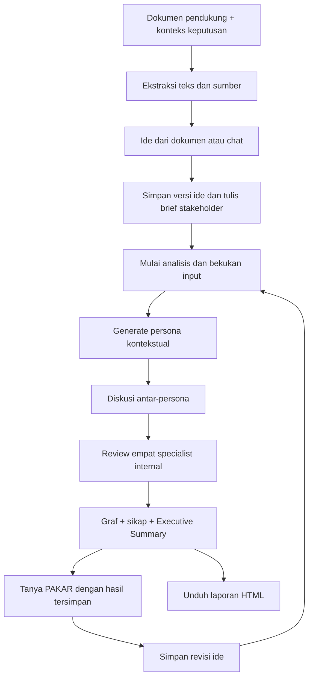
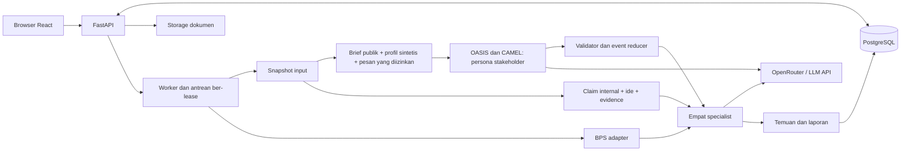

# PAKAR — Bahan Proposal, Tech Stack, dan Alur Sistem

Referensi implementasi per 7 November 2026. Disusun dari kode produk bisnis, konfigurasi dependency, PRD v1.1, dan bukti pengujian tersimpan. Versi paket adalah versi yang dipakai/dikunci proyek atau rentang deklarasi, bukan klaim versi terbaru di internet. Kredensial dan isi konfigurasi rahasia tidak disertakan.

## 1. Identitas dan posisi produk

Judul usulan: **PAKAR: Platform AI Co-Analyst untuk Evaluasi Ide Bisnis melalui Simulasi Multi-Agent Berbasis Bukti**.

PAKAR membantu Business Analyst, tim perencanaan strategis, tim inovasi, dan pendiri usaha menguji ide atau keputusan bisnis melalui berbagai perspektif stakeholder. Dokumen, ide, diskusi antar-persona, pemeriksaan specialist, dan sumber pendukung dihubungkan sehingga pengguna dapat melihat alasan di balik temuan dan menentukan validasi berikutnya.

PAKAR merupakan alat pendukung pengambilan keputusan. Dukungan persona adalah posisi dalam simulasi, bukan survei konsumen, prediksi penjualan, atau persetujuan kelayakan bisnis. Identitas merek yang sudah tersedia adalah PAKAR; dokumen ini tidak mengarang kepanjangan akronimnya.

Produk bisnis dikembangkan di atas fondasi MiroFish/codebase terdahulu. Kontribusi proyek perlu dijelaskan sebagai adaptasi dan pengembangan: model domain bisnis, batas informasi stakeholder, orkestrasi diskusi, validasi aksi, pemeriksaan specialist, sumber terlacakan, serta pengalaman pengguna PAKAR. Infrastruktur upstream bukan diklaim dibuat dari nol.

## 2. Ringkasan eksekutif siap diadaptasi

Evaluasi ide bisnis membutuhkan pemeriksaan yang mencakup kebutuhan konsumen, diferensiasi produk, kondisi operasional, keuangan, dan potensi risiko. Informasi tersebut sering tersebar dalam dokumen dan asumsi tim, sementara review dari satu perspektif dapat melewatkan pertentangan kepentingan antar-stakeholder. PAKAR dikembangkan sebagai platform AI Co-Analyst untuk membantu pengguna menemukan blind spot sebelum keputusan bisnis diambil.

Pengguna mengunggah dokumen pendukung, menyampaikan ide melalui teks atau dokumen, dan menetapkan informasi yang boleh dibagikan kepada stakeholder simulasi. Sistem membentuk persona sesuai konteks, menjalankan percakapan berbatas ronde, lalu memeriksa hasilnya melalui Market, Finance, Legal/Compliance, dan Risk Agent. Temuan disajikan melalui graf interaksi, distribusi sikap persona, Executive Summary, sumber yang dapat ditelusuri, dan saran validasi. Pengguna dapat membahas hasil melalui chat serta menyimpan revisi ide untuk diuji pada analisis terpisah.

Implementasi memanfaatkan React dan TypeScript, FastAPI, PostgreSQL, serta runtime OASIS/CAMEL dengan akses model melalui API kompatibel OpenAI. Integrasi BPS menyediakan konteks statistik yang masih perlu diperiksa kesesuaiannya. Prototipe telah menjalankan diskusi dan chat dengan model AI nyata. Evaluasi lanjutan diperlukan untuk mengukur kualitas temuan, ketepatan rujukan, manfaat bagi analis, dan perbandingan terhadap pendekatan satu agent.

## 3. Masalah, tujuan, dan pengguna

| Aspek | Bahan untuk proposal |
| --- | --- |
| Masalah utama | Asumsi dan dokumen bisnis belum selalu ditinjau dari berbagai kepentingan; alasan sebuah rekomendasi dapat sulit ditelusuri. |
| Tujuan | Membantu menemukan pertanyaan kritis, konflik kepentingan, kekurangan bukti, dan langkah validasi berikutnya. |
| Pengguna utama | Business Analyst, Strategic Planning, tim inovasi/product development. |
| Pengguna sekunder yang dapat diuji | Pendiri startup, pelaku UMKM dengan dokumen yang memadai, konsultan, dan inkubator. |
| Input | Dokumen riset/temuan, ide, pertanyaan keputusan, konteks bisnis, brief untuk stakeholder. |
| Output | Graf interaksi dan sikap, alasan per persona, temuan prioritas, saran validasi, laporan HTML, serta percakapan lanjutan. |
| Manfaat yang ingin dibuktikan | Review lebih terstruktur dan beragam perspektif, dengan penelusuran dari temuan menuju sumber atau pesan. |
| Klaim yang belum boleh dianggap hasil evaluasi | Penghematan waktu dalam persentase tertentu, peningkatan akurasi keputusan, ROI, dan keunggulan multi-agent terhadap single-agent. |

## 4. Arsitektur dua lapisan agent

### 4.1 Simulation personas: pihak yang menilai dari sudut pandangnya

| Perspektif | Fokus dalam simulasi |
| --- | --- |
| Customer/calon pembeli | Manfaat, hambatan mencoba, kebingungan penggunaan, kebutuhan dan syarat membeli. |
| Supplier/pemasok | Spesifikasi, ketersediaan bahan, risiko pasokan dan syarat kerja sama hipotetis. |
| Competitor/pesaing hipotetis | Diferensiasi, alternatif dan kemudahan peniruan; tidak mengaku mengetahui strategi rahasia pesaing nyata. |
| Investor | Kebutuhan modal dan bukti pengembalian/permintaan; hadir bila konteks relevan. |
| Partner/distributor | Kanal, kemasan, distribusi dan bentuk kerja sama. |
| Regulator/perspektif peninjau klaim | Kejelasan klaim dan bukti yang dibutuhkan, tanpa menerbitkan putusan hukum. |
| Operator/fasilitator produk | Membahas konsep dan tradeoff dari informasi yang dibagikan dalam ruang stakeholder. |

Peran dipilih dari kontrak/katalog yang didukung dan konteks dokumen. Ini bukan pembentukan sembarang profesi tanpa batas. Sumber peran, atribut yang diasumsikan dan profil sintetis dibedakan. Jumlah persona dapat dikonfigurasi dan bukan bobot atau proporsi populasi.

Persona dapat saling bertanya, menjawab, menyanggah dan mengusulkan perubahan. Balasan mencatat penerima, thread, pesan yang dirujuk, ronde dan sikap. Sikap meliputi mendukung, menolak, bersyarat, dan belum memutuskan. Data sikap yang hilang dicatat terpisah.

### 4.2 Analytical specialists: reviewer internal

| Agent | Peran |
| --- | --- |
| Market Agent | Memeriksa asumsi pasar, kebutuhan dan relevansi respons stakeholder terhadap konteks/sumber. |
| Finance Agent | Memeriksa input biaya, harga, satuan dan hasil perhitungan bersyarat. |
| Legal/Compliance Agent | Mengangkat pertanyaan klaim dan kepatuhan untuk diperiksa pihak kompeten. |
| Risk Agent | Mengidentifikasi risiko, ketergantungan dan potensi dampak lintas fungsi. |

Review memakai dua gelombang pasangan: Market + Finance, lalu Legal/Compliance + Risk, dengan konteks peer yang dibekukan per gelombang. Konkurensi dibatasi satu atau dua reviewer. Temuan harus memenuhi skema serta referensi yang diketahui server. Temuan AI tetap memerlukan validasi.

Empat specialist bukan batas jumlah persona. Satu model LLM dapat menjalankan banyak peran melalui konteks dan instruksi yang berbeda; proyek tidak melatih empat model dasar terpisah. Orchestrator terutama merupakan logika service, worker, scheduler dan validator, bukan klaim adanya model kelima yang selalu otonom.

### 4.3 Dua fasilitator yang perlu dibedakan

Fasilitator produk di ruang stakeholder hanya mengetahui brief yang dibagikan dan percakapan yang diizinkan. **Fasilitator PAKAR di chat pengguna** adalah co-analyst internal yang membahas ide, kutipan sumber dan hasil analisis terpilih. Keduanya tidak diberi akses pengetahuan yang sama.

## 5. Flow pengguna

1. **Masuk dan buat proyek.** Pengguna mengisi nama analisis dan keputusan yang ingin dinilai; industri, wilayah dan segmen target dapat melengkapi konteks.
2. **Unggah dokumen pendukung.** PDF berisi teks, DOCX, TXT atau Markdown diekstrak menjadi segmen dan kandidat claim dengan lokasi sumber. Dokumen ide dibedakan dari dokumen evidence.
3. **Sampaikan ide.** Ide dapat diketik/dibahas lewat ruang chat atau bersumber dari dokumen. Simpan versi ide ketika siap diuji. Intake juga mendukung analisis langsung tanpa chat pendahuluan.
4. **Tentukan brief stakeholder.** Pengguna menulis konsep yang sengaja boleh diketahui pihak eksternal. Dokumen internal dan ide lengkap tidak otomatis menjadi pengetahuan customer/pesaing.
5. **Mulai analisis secara eksplisit.** Jalur cepat menyiapkan input dan persona otomatis. Jalur review manual memungkinkan pemeriksaan claim dan persona. Snapshot input dan versi ide dibekukan.
6. **Amati simulasi.** Persona saling menanggapi dalam ronde terbatas. Server memeriksa aksi, akses pesan, rujukan dan perubahan sikap, serta menyimpan event yang diterima.
7. **Baca hasil.** Tab Ringkasan membuka graf dan jumlah sikap; klik persona untuk alasannya. Executive Summary di bawah graf berisi kesimpulan dan kekurangan yang terhubung dengan diskusi, beserta saran berikutnya. Tab Diskusi memuat percakapan tersimpan.
8. **Bahas melalui Tanya PAKAR.** Pilih fasilitator atau satu specialist untuk setiap pesan. Balasan tersimpan dan dapat membuka sumber. Mengirim chat memakai provider; membuka halaman tidak menjalankan AI.
9. **Perbaiki dan uji lagi.** Simpan revisi ide lalu mulai run baru, atau gunakan fitur skenario terpisah. Baseline lama tetap dapat diperiksa. Chat tidak otomatis mengubah hasil atau mengajak seluruh swarm berdebat lagi.

## 6. Flow teknis dan batas informasi

| Tahap | Komponen dan proses | Data yang disimpan |
| --- | --- | --- |
| Intake | FastAPI memvalidasi kepemilikan, tipe/ukuran berkas dan konteks proyek. | Metadata proyek dan dokumen. |
| Ekstraksi | PyMuPDF/python-docx mengekstrak teks; pemrosesan segmen menyimpan locator. | Claim, kutipan, halaman/paragraf/tabel atau rentang karakter yang tersedia. |
| Konteks | Versi ide, claim terpilih, konfigurasi, brief dan model dibekukan. | Snapshot analisis yang dapat dirujuk kembali. |
| Persiapan persona | Discovery LLM terstruktur atau fallback kontekstual berlabel. | ID persona, peran, atribut, provenance dan status review. |
| Pengayaan | Adapter BPS mengambil indikator yang dikurasi sesuai wilayah/periode/satuan. | Evidence dan status dukungan; kegagalan tetap unavailable. |
| Eksekusi | Worker menjalankan bridge JSON ke runtime Python OASIS/CAMEL terisolasi. | Event, thread, balasan, sikap dan usage. |
| Validasi | Reducer server memeriksa aktor/penerima, visibility, versi state dan referensi event. | Aksi diterima/ditolak serta state yang sah. |
| Review | Specialist memeriksa input internal dan hasil simulasi dalam konteks terbatas. | Finding, referensi, perbedaan pendapat dan tugas validasi. |
| Penyajian | API memproyeksikan hasil tersimpan; React menampilkan graf/summary/chat. | Hasil lama tetap; membaca summary/export tidak memerlukan inference baru. |

Pemisahan informasi menerapkan allowlist konteks di server. Customer, pemasok, pesaing dan fasilitator stakeholder tidak menerima seluruh dokumen/angka internal. Specialist dan chat internal memperoleh kutipan serta data yang dipilih dalam batas konteks, bukan jaminan seluruh isi dokumen masuk sekaligus ke model. Data internal yang dipakai reviewer tetap dapat dikirim ke provider cloud sesuai konfigurasi. Batas peran simulasi tidak sama dengan enterprise RBAC, inferensi privat atau DLP otomatis atas brief yang sengaja ditulis pengguna.

## 7. Tech stack frontend

| Kebutuhan | Teknologi / versi repo | Peran dan status |
| --- | --- | --- |
| UI | React + React DOM 19.2.7 | SPA aktif, function components dan hooks. |
| Bahasa | TypeScript 6.0.3 pada lockfile; deklarasi ~6.0.2 | Tipe API, data dan komponen. |
| Build/dev server | Vite 8.1.4 pada lockfile; deklarasi ^8.1.1 | Bundling dan development server. |
| Transform/compiler | @vitejs/plugin-react, @rolldown/plugin-babel, babel-plugin-react-compiler | Toolchain build React. |
| Routing | react-router-dom 7.18.1 | Halaman proyek, analisis dan chat. |
| Server state | @tanstack/react-query 5.101.4 | Fetch, cache, invalidation dan polling status. |
| Graf hasil bisnis | SVG khusus + React | Node persona, filter sikap, seleksi keyboard dan koneksi event. Bukan React Flow. |
| Graf lain/legacy | d3-force, d3-drag, d3-selection, d3-zoom 3.x | Dependensi visualisasi yang sudah ada; bukan engine AI. |
| Avatar lokal | @dicebear/core 10.7.0 + @dicebear/styles 10.6.0 | Personas untuk manusia, Fun Emoji untuk agent internal. SVG dibuat lokal. |
| Identitas avatar | Seed persona.id + namespace agent + cache hingga 2.048 entri | Identitas stabil, tanpa API avatar atau random seed saat render. |
| Konten | react-markdown 10.1.0 + remark-gfm 4.0.1 | Markdown aman dan GFM; raw HTML/gambar eksternal dibatasi. |
| Styling | CSS biasa + CSS custom properties | IBM Plex/Carbon-inspired, bidang netral, aksen biru, responsif; tidak memerlukan Tailwind. |
| Font | @fontsource/ibm-plex-sans 5.2.8 | Dibundel lokal. |
| Ikon hasil | SVG komponen internal | Ikon kecil konsisten untuk tab dan aksi. |
| Dependency install | npm + package-lock.json | Dipakai Docker/CI; bun.lock juga tersedia, bukan kebutuhan runtime server. |

Library DiceBear dan artwork adalah dua lapisan lisensi berbeda. Repo menyimpan atribusi; halaman resmi Personas dan Fun Emoji mencantumkan CC BY 4.0 untuk artwork. Avatar digunakan sebagai identitas ilustratif, tanpa menyimpulkan umur, gender atau etnis dari nama/peran.

## 8. Tech stack backend dan pengolahan data

| Kebutuhan | Teknologi / versi | Peran dan status |
| --- | --- | --- |
| Bahasa utama | Python >=3.11; image deploy Python 3.12-slim | API dan worker. Interpreter lokal yang diperiksa: 3.13.9. |
| Web API | FastAPI; lokal 0.162.0, deklarasi >=0.139,<1 | REST API utama, autentikasi dan endpoint bisnis. |
| Server ASGI | Uvicorn; lokal 0.54.0 | Menjalankan FastAPI. |
| Validasi | Pydantic 2.x; lokal 2.12.4 | Kontrak input, persona, aksi, finding dan chat. |
| Request file | python-multipart + Werkzeug | Upload multipart dan nama berkas aman. |
| PDF | PyMuPDF; lokal 1.28.2 | Ekstraksi PDF berisi teks; bukan OCR otomatis. |
| DOCX | python-docx 1.2.0 + lxml | Ekstraksi paragraf dan tabel. |
| Database | PostgreSQL 17-alpine pada Compose | Penyimpanan proyek, versi ide, analisis, event, chat dan ledger biaya. |
| Akses database | SQLAlchemy Core 2.x; lokal 2.0.43 | Tabel/query/transaksi dan JSONB. |
| Driver | psycopg 3.x; lokal 3.3.6 | Koneksi PostgreSQL. |
| Migrasi | Alembic; lokal 1.18.3 | Migrasi skema; perubahan bisnis sampai 0017_provider_spending tersedia. |
| Penyimpanan file | Local filesystem | Backend storage aktif pada konfigurasi demo yang diperiksa. |
| Storage alternatif | firebase-admin, adapter Firebase Storage | Opsional; keberadaan adapter bukan bukti cloud production sudah dipakai. |
| Konfigurasi | python-dotenv + environment variables | Kunci/model, database, storage, runtime dan budget. Tidak dimasukkan ke frontend. |
| Kalkulasi bisnis | decimal.Decimal dan reducer Python | Margin, break-even dan profit bersyarat; data hilang tetap unknown. |
| Job async | Worker Python + tabel jobs PostgreSQL | Lease, heartbeat, status, idempotensi dan kontrol pembatalan. Tidak menggunakan Celery/Redis. |
| Update UI | Polling React Query; endpoint stream event juga tersedia | Progress dan event yang dipersist, bukan jaminan streaming token model. |
| Keamanan login | pwdlib/Argon2 + session cookie server-side | Identitas pengguna dan pemeriksaan kepemilikan resource. |

PostgreSQL menggunakan tabel terstruktur dan kolom JSONB. Entitas bisnis meliputi business_projects, business_documents, business_claims, business_personas, business_analyses, business_events, business_ideas, business_idea_revisions dan business_chat_turns. Ledger biaya menggunakan provider_spend_accounts dan provider_spend_reservations. Tabel users, sessions dan jobs dibagi dengan infrastruktur lama. JSONB tidak berarti database vektor.

## 9. Tech stack AI dan simulasi

| Lapisan | Teknologi | Penjelasan penting |
| --- | --- | --- |
| Akses model | OpenRouter melalui API kompatibel OpenAI | Gateway/routing provider, bukan framework swarm. |
| SDK backend | openai; lokal 2.54.0 | Klien API kompatibel OpenAI; penggunaannya tidak berarti model yang dipakai selalu model OpenAI. |
| Model demo saat diperiksa | qwen/qwen3-235b-a22b-2507 | Dipilih lewat konfigurasi; snapshot run lama bisa memakai model lain. |
| Provider chat live terakhir | DeepInfra, melalui OpenRouter | Berasal dari usage respons tersimpan, bukan asumsi bahwa semua provider selalu sama. |
| Engine agent | camel-oasis 0.2.5 | Runtime SocialAgent/AgentGraph yang diintegrasikan ke domain bisnis. |
| Framework agent | camel-ai 0.2.78 | Model backend, agent dan konteks/memori runtime. |
| Isolasi dependency | Runtime Python terpisah + uv/uv.lock | Runtime mendeklarasikan Python >=3.11,<3.13; tidak disamakan dengan interpreter API lokal 3.13.9. |
| Bridge | Subprocess + protokol JSON stdin/stdout | Menghubungkan API/worker dengan lingkungan OASIS/CAMEL. |
| Output model | JSON Schema/JSON object + validasi server | Format terstruktur dibatasi menurut peran dan referensi yang diketahui. |
| Orkestrasi domain | BusinessService, ReactiveAgenda, DialogueSimulation/SwarmSimulation | Penjadwalan giliran, balasan, ronde, state dan kondisi berhenti. |
| Aturan kebenaran state | Reducer/validator Python | Model mengusulkan aksi; server memutuskan apakah aksi boleh mengubah state. |
| Evidence kontekstual | Pemilihan claim/kutipan dengan term matching dan batas konteks | Source-grounded context; belum ada pipeline vector embedding/semantic RAG khusus di produk bisnis. |
| Memori/persistensi | Konteks agent runtime + event/snapshot/chat di PostgreSQL | Runtime juga menggunakan artefak SQLite; bukan database utama aplikasi. |
| Guard biaya | Ledger reservasi persisten, batas run/token/waktu dan cadangan kredit | Nilai biaya tidak diketahui mempertahankan reservasi konservatif; tidak ada retry berbayar otomatis untuk run bisnis/chat yang baru. |
| Mode pengujian | Fixture sintetis berlabel | Berguna untuk regresi; tidak boleh dipresentasikan sebagai AI live. |

OASIS/CAMEL adalah dependensi yang dijalankan di server, bukan API key tambahan. Endpoint LLM dan kunci model tetap diperlukan agar agent menghasilkan respons live. Menambah persona, ronde, panjang konteks, reviewer dan retry eksplisit dapat menambah jumlah panggilan serta biaya.

Flask/flask-cors dan zep-cloud 3.25.0 tercantum dalam runtime warisan. API bisnis utama menggunakan FastAPI. Zep Cloud tidak dikonfigurasi pada demo bisnis yang diperiksa dan bukan prasyarat untuk menyebut jalur simulasi bisnis ini sudah berjalan. Integrasi knowledge graph temporal dari workflow lama harus diberi label legacy/opsional, bukan fitur aktif yang terverifikasi pada demo ini.

## 10. Integrasi eksternal, deployment, dan testing

| Kategori | Komponen | Status yang tepat untuk proposal |
| --- | --- | --- |
| Statistik resmi | Web API BPS | Adapter nyata dan konfigurasi indikator tersedia. Relevansi indikator/wilayah/periode/satuan masih harus diperiksa. |
| Evidence lain di PRD | Bank Indonesia, regulasi resmi, sistem internal | Arah pengembangan; jangan ditulis sebagai semua konektor otomatis sudah aktif. |
| Container | Docker multi-stage + Docker Compose | Definisi database, migrasi, API, worker dan opsi frontend tersedia. |
| Frontend build | Node 22-alpine pada Dockerfile | Tahap build, bukan backend AI. |
| Web server | nginx 1.29-alpine | Menyajikan SPA dan reverse proxy ke backend. |
| CI | GitHub Actions | Konfigurasi unit test, migrasi, lint, build, browser dan build image tersedia. |
| CD | Workflow SSH ke VM | Otomasi deployment disediakan; bukan bukti layanan publik telah dideploy. |
| Hosting alternatif | Konfigurasi Vercel frontend | Pilihan untuk build SPA; backend/worker/database tetap memerlukan hosting sendiri. |
| Observability | /health, /ready, /metrics + log | Health/readiness dan endpoint metrik berformat Prometheus; belum berarti ada dashboard Grafana/Prometheus production. |
| Unit/component frontend | Vitest, Testing Library, jsdom | Perilaku komponen dan state. |
| Mock API test | MSW | Hanya pengujian terkontrol, bukan hasil bisnis live. |
| Browser test | Playwright/Chromium | Navigasi, responsive, keyboard dan integrasi UI. |
| Lint dan type/build | ESLint, typescript-eslint, TypeScript, Vite | Pemeriksaan statis dan hasil build. |
| Backend test | pytest, httpx, jsonschema | Kontrak, API, simulator, sumber, spending dan recovery dengan database test terpisah. |

BPS memberi konteks statistik; statistik penduduk tidak otomatis menjadi demand produk. Hasil dapat berstatus PARTIAL, UNAVAILABLE atau STALE. Bukti resmi tidak otomatis memverifikasi setiap claim dari dokumen.

## 11. Output yang perlu ditunjukkan dalam proposal/demo

| Keluaran | Isi dan kegunaan |
| --- | --- |
| Graf | Persona beserta identitas stabil dan garis interaksi/reply yang benar-benar tercatat. |
| Distribusi sikap | Jumlah mendukung, menolak, bersyarat dan belum memutuskan; satu persona aktif dihitung sekali, specialist di luar denominator. |
| Alasan persona | Penjelasan sikap terakhir yang tersimpan dan akses ke percakapannya. |
| Executive Summary | Kesimpulan singkat, tiga temuan awal yang terkait diskusi, saran berikutnya dan alasan yang dapat dibuka. |
| Diskusi | Pesan, penerima, ronde dan balasan; membantu memeriksa asal temuan. |
| Tanya PAKAR | Follow-up dengan fasilitator atau satu specialist, sumber bernomor dan balasan persisten. |
| Laporan HTML | Delapan bagian PRD: Executive Summary, Assumption Register, Top Blind Spots, Evidence Table, Contradictions, Scenario Impact, Recommended Validation Tasks, Limitations. UI normal tetap disederhanakan. |
| Scenario comparison | Run terpisah untuk perubahan kondisi, perbandingan input/state/metrik dan temuan; akses teknis tersedia di luar menu normal tiga tab. |

Pembacaan Executive Summary dan ekspor HTML merupakan proyeksi data tersimpan, bukan panggilan model tambahan. Laporan HTML dapat dicetak dari browser; native PDF/DOCX export bukan fitur produk yang diklaim sudah tersedia. File DOCX bahan proposal ini dibuat untuk dokumentasi, bukan fitur ekspor analisis aplikasi.

## 12. Contoh konkret: konsep pasta gigi dua rasa dan perubahan warna

Input: dokumen temuan dan ide satu tube dengan dua rasa sesuai waktu penggunaan, serta perubahan warna setelah sekitar dua menit menyikat. Brief hanya membagikan informasi yang memang boleh diketahui stakeholder.

Persona dapat memperdebatkan kemudahan pemilihan rasa, konsistensi perubahan warna, kejelasan manfaat, kebutuhan spesifikasi pemasok dan diferensiasi. Reviewer internal memeriksa apakah sumber yang tersedia mendukung klaim tersebut. Perubahan warna sendiri belum membuktikan kebersihan gigi atau efektivitas klinis.

Bukti run tersimpan: delapan persona, tiga ronde, 27 pesan, 18 pasangan balasan terarah, tujuh pasangan yang saling membalas, sepuluh balasan antarcustomer dan empat specialist selesai. Semua delapan sikap akhir tetap belum memutuskan. Ini contoh penting: sistem tidak memaksakan dukungan agar grafik terlihat positif. Ada pesan berulang/pertanyaan yang belum terjawab; jumlah pesan bukan ukuran otomatis kedalaman diskusi.

Pengguna bisa bertanya melalui chat tentang alasan keraguan, memberi penjelasan mekanisme tube, lalu menyimpan revisi. Chat tidak mengubah delapan sikap lama. Penilaian ulang memerlukan run baru. Skenario tambahan yang belum diuji harus tetap disebut usulan.

## 13. Nilai pembeda yang dapat dijelaskan secara jujur

1. **Dua lapisan perspektif:** pihak yang bereaksi terhadap ide dipisahkan dari reviewer internal yang memeriksa sumber.
2. **Diskusi antar-stakeholder:** customer dapat menanggapi customer atau stakeholder lain, dengan thread dan rujukan yang diperiksa.
3. **Batas informasi per peran:** data internal tidak otomatis dibagikan ke pesaing/customer simulasi.
4. **Penelusuran temuan:** sumber, claim dan interaksi terkait tetap dapat dibuka, dengan label asumsi/sintetis/belum terverifikasi.
5. **Iterasi yang terpisah:** ide mempunyai revisi dan run mempunyai snapshot, sehingga revisi tidak menulis ulang hasil lama.
6. **Kontrol operasional:** batas biaya, token dan waktu serta penyimpanan hasil parsial mengurangi kebutuhan mengulang analisis dari nol.

Poin di atas adalah deskripsi rancangan/implementasi. Klaim kebaruan penelitian, paten atau keunggulan kompetitif perlu kajian pembanding tersendiri.

## 14. Status fitur dan batas yang harus jujur di proposal

| Sudah diimplementasikan/diuji pada lingkupnya | Masih perlu pengembangan atau pembuktian |
| --- | --- |
| Upload dan ekstraksi dokumen teks, claim dan locator. | OCR untuk PDF scan dan peningkatan parsing dokumen sulit. |
| Versi ide, persistent chat dan konteks analisis terpilih. | Chat pengguna langsung ke persona stakeholder individual. |
| Persona kontekstual, diskusi threaded/reactive dan sikap. | Kualitas argumen, pengurangan repetisi dan hallucination secara lebih luas. |
| Empat specialist dan temuan yang direferensikan. | Review ahli independen dan evaluasi kualitas temuan lintas industri. |
| Graph/summary/chat yang diuji responsive dan keyboard. | Uji kegunaan pada target pengguna nyata. |
| Adapter BPS dan konfigurasi indikator tertentu. | Cakupan indikator lebih luas, rekonsiliasi publikasi dan kecocokan claim bisnis. |
| Perhitungan unit economics bersyarat dan skenario terpisah. | Prediksi demand atau calibrated feasibility score; belum diklaim tersedia. |
| Session login, ownership, budget dan audit event. | Enterprise RBAC, private inference/DLP menyeluruh dan pembuktian operasional backup/retensi. |
| Build/test dan konfigurasi deployment. | Klaim layanan production siap skala besar atau SLA teruji. |

Kontrak quick analysis memiliki default maksimum delapan persona dan tiga ronde, dengan batas maksimum dua belas persona pada jalur tersebut. Jalur konfigurasi analisis manual mendukung batas sampai dua puluh empat persona. Ini batas konfigurasi, bukan bukti kualitas live pada semua jumlah. Pengujian graf 120 node adalah pengujian rendering, bukan simulasi AI live 120 persona. Batas waktu dan biaya dapat menghasilkan keluaran parsial.

Belum ada bukti aplikasi memakai Next.js, React Flow, Tailwind, LangChain, LangGraph, Celery, Redis, Pinecone atau database embedding khusus pada jalur bisnis yang ditinjau. Jangan menambahkannya ke diagram proposal hanya karena umum pada aplikasi AI.

## 15. Keamanan, biaya dan prasyarat demo

| Area | Yang perlu dijelaskan |
| --- | --- |
| Data | Pilot dibatasi data publik, sintetis atau non-rahasia; pengguna mengatur brief eksternal. |
| Identitas | Login session, password Argon2 dan pemeriksaan kepemilikan proyek/analisis. |
| Kunci API | Disimpan di environment backend, tidak di browser atau proposal. |
| Akses provider | Model cloud menerima konteks yang dikirim service; tidak mengklaim seluruh pemrosesan offline. |
| Prompt injection | Dokumen/pesan diperlakukan sebagai data tidak tepercaya; skema dan validasi server tetap dibutuhkan. |
| Angka | Input hilang tidak ditebak; output finansial harus menyebut satuan, periode dan asumsi. |
| Biaya inference | Dipengaruhi model/provider, token input-output, persona, ronde, review dan panjang sejarah chat. |
| Guard | Batas biaya per run, reservasi persisten, cadangan kredit, batas token/waktu dan tanpa retry berbayar otomatis. |
| Komponen biaya lain | Hosting API/worker/frontend, database, storage, backup dan operasional. |
| Lisensi/atribusi | Runtime warisan mendeklarasikan AGPL-3.0; DiceBear menyimpan notices. Catat dependensi dan sumber upstream dalam lampiran. |

Rumus perkiraan inference: jumlahkan setiap panggilan [(token input / 1.000.000 × tarif input) + (token output / 1.000.000 × tarif output)], ditambah biaya provider lain bila ada. Gunakan tarif provider yang berlaku ketika RAB dibuat; angka historis tidak dipakai sebagai jaminan harga.

Contoh pengukuran, bukan estimasi semua run: satu chat live tersimpan memakai Qwen3 235B melalui OpenRouter/DeepInfra, 3.740 token, sekitar 46 detik, dan biaya provider-terlapor USD 0,00055556. Biaya satu chat tidak sama dengan biaya discovery + seluruh percakapan persona + empat review. Saldo aktual dan harga harus diperiksa terpisah saat demo/RAB.

Prasyarat demo lokal: frontend dan backend berjalan, PostgreSQL tersedia dan migrasi sesuai, runtime OASIS/CAMEL terpasang pada interpreter yang kompatibel, LLM key valid serta saldo mencukupi. BPS memerlukan API key dan katalog indikator yang cocok untuk wilayah. File contoh dan hasil live yang tersimpan bisa dipakai untuk menjelaskan alur tanpa menjalankan inference ulang.

## 16. Rencana evaluasi untuk proposal

| Pertanyaan evaluasi | Metode usulan | Metrik usulan; bukan hasil yang sudah dicapai |
| --- | --- | --- |
| Apakah temuan relevan? | Rubrik ahli pada kasus yang sama. | Proporsi temuan relevan/berguna dan tingkat severity yang disepakati. |
| Apakah sumber mendukung klaim? | Audit isi rujukan, bukan hanya ID valid. | Dukungan semantik, ketepatan kutipan dan unsupported-claim rate. |
| Apakah multi-agent memberi manfaat? | Bandingkan single-agent dan PAKAR dengan sumber serta budget yang sebanding. | Tambahan blind spot valid, kualitas alasan, biaya dan latency. |
| Apakah diskusinya substantif? | Penilaian ahli pada pertanyaan, jawaban dan sanggahan. | Respons yang menjawab pemicu, repetisi dan perubahan sikap beralasan. |
| Apakah batas informasi terjaga? | Uji marker dan inspeksi request pada skenario kebocoran. | Kebocoran ke konteks stakeholder; tetap bukan jaminan DLP semantik. |
| Apakah user memahami output? | Uji tugas dengan Business Analyst/pengguna sasaran. | Waktu menemukan alasan, ketepatan interpretasi sikap dan kegunaan saran. |
| Apakah operasional cukup andal? | Skenario timeout, provider gagal, cancel, reload dan pemulihan. | Completion/partial rate, data tersimpan, biaya diketahui dan pemulihan. |

Matriks dataset sebaiknya mencakup ide yang masuk akal, ide dengan klaim manfaat tanpa bukti, dokumen dengan angka/satuan bertentangan, data BPS tidak relevan, dan dokumen berisi instruksi berbahaya. Gunakan label reviewer independen dan jangan mengubah ground truth agar cocok dengan output model.

Bukti teknis terakhir untuk tampilan hasil: 108 tes frontend pada 20 file, empat workflow browser, lint dan build lolos. Pemeriksaan actual-API membuktikan pemuatan hasil, sumber, draft, baseline tetap dan tidak ada panggilan berbayar tambahan. Pengujian backend tersedia dan pernah dijalankan pada checkpoint terdahulu; dokumen ini tidak mengklaim seluruh backend suite baru dijalankan ulang hari ini. Keberhasilan teknis tidak menggantikan evaluasi efektivitas bisnis.

## 17. Kerangka proposal yang bisa dipakai

| Bagian | Isi yang disiapkan |
| --- | --- |
| Judul dan abstrak | Identitas produk, masalah, pendekatan dan batas klaim. |
| Latar belakang | Bukti kebutuhan review bisnis dan masalah dari wawancara/literatur; statistik harus diberi sumber. |
| Rumusan masalah | Kekurangan perspektif, sumber yang sulit ditelusuri dan kebutuhan iterasi ide. |
| Tujuan/manfaat | Temuan yang lebih terstruktur dan rencana pembuktian manfaat untuk target pengguna. |
| Pengguna/use case | Analis atau tim inovasi; contoh Pepsodent sebagai konsep hipotetis. |
| Tinjauan solusi/pembanding | Proses manual, single-agent dan sistem multi-agent yang relevan; hindari klaim paling unggul tanpa eksperimen. |
| Rancangan sistem | Dua lapisan agent, flow, model data, stack, batas informasi dan kontrol biaya. |
| Implementasi | Modul yang tersedia dan bukti demo/test. |
| Pengujian | Evaluasi fungsional, validitas sumber, kualitas diskusi, ablation dan uji kegunaan. |
| Luaran | Aplikasi, sumber kode, dokumentasi, dataset/rubrik evaluasi yang disanitasi dan laporan hasil pengujian. |
| Jadwal | Fase validasi kualitas, pengayaan evidence, uji pengguna dan hardening; durasi ditentukan sesuai program/tim. |
| RAB | API inference, hosting, database/storage, backup dan kegiatan validasi pengguna/ahli. |
| Risiko dan mitigasi | Hallucination, sumber tidak relevan, privasi, biaya, timeout, bias persona dan salah tafsir jumlah dukungan. |
| Lampiran | Diagram, screenshot, kontrak input-output, ringkasan benchmark, atribusi dan lisensi. |

Hipotesis model bisnis, bila proposal memerlukannya: SaaS per workspace atau paket pemakaian analisis. Ini opsi yang perlu validasi willingness-to-pay; billing/subscription bukan fitur yang diklaim telah diimplementasikan. Ukuran pasar, tarif jual, target pendapatan, ukuran tim dan jadwal belum diberikan sehingga tidak diisi dengan angka rekaan.

## 18. Referensi implementasi dan dokumentasi resmi

Sumber implementasi utama:

- `PRODUCT.md`: definisi produk dan pengalaman pengguna terkini.
- `docs/PAKAR_PRD_REVISION_v1.1.md`: visi dan kebutuhan bisnis.
- `frontend/package.json` dan `frontend/package-lock.json`: dependency frontend.
- `backend/pyproject.toml`: dependency API/worker.
- `backend/oasis_engine_runtime/pyproject.toml` dan `uv.lock`: runtime terisolasi.
- `backend/app/business/service.py`, `oasis_bridge.py`, `reviews.py`, `information.py`: pipeline dan batas pengetahuan.
- `backend/app/business/conversation.py`, `spending.py`, `evidence.py`, `reporting.py`: chat, biaya, BPS dan ekspor.
- `backend/app/business/tables.py`: data bisnis dan ledger.
- `compose.yaml`, Dockerfile frontend/backend dan `.github/workflows/ci.yml`: deployment dan CI.
- `frontend/src/pages/Business/BusinessResultGraph.tsx` dan `resultSummary.ts`: graf dan penghitungan sikap.
- `frontend/public/avatar-licenses.txt`: attribution artwork.
- `backend/data/demo/pepsodent-public-2026-11-03-v3/verification.json`: bukti simulasi live tersimpan.
- `backend/data/runtime-audit/2026-11-06/live-ai-followup/verification.json`: bukti satu chat AI live.
- `docs/PAKAR_RESULT_CANVAS_2026-11-07.md`: verifikasi tampilan terbaru.

Dokumentasi upstream yang ditinjau sebagai referensi teknologinya, bukan bukti semua kemampuan upstream dipakai PAKAR:

- OASIS: https://github.com/camel-ai/oasis
- CAMEL: https://github.com/camel-ai/camel
- OpenRouter structured outputs: https://openrouter.ai/docs/guides/features/structured-outputs
- Web API BPS: https://webapi.bps.go.id/developer/
- DiceBear Personas: https://www.dicebear.com/styles/personas/
- DiceBear Fun Emoji: https://www.dicebear.com/styles/fun-emoji/

`TECH_STACK.md` yang lama berfokus pada workflow kebijakan/warisan. Untuk proposal bisnis, gunakan dokumen ini dan rujukan kode bisnis di atas agar kemampuan legacy tidak tercampur dengan fitur aktif.
